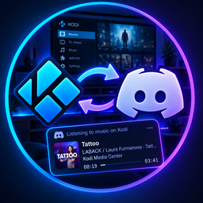
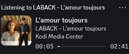
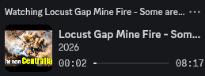

# 🎬 KodiCord — Discord Rich Presence for Kodi

> Show what you're watching or listening to on Kodi — live, in your Discord status.
> Works **locally** (Kodi + Discord on the same PC) and **remotely** (e.g. LibreELEC → a PC running Discord).

---

## ✨ Features

- 🎥 **Video presence** — movies, TV shows, YouTube and general streams, with thumbnails
- 🎵 **Music presence** — track, artist and album, with album art
- ⏸️ **Pause / resume / stop** handling — timestamps freeze on pause, presence clears on stop
- 🖼️ **Thumbnails** — resolves Kodi `image://` URLs, YouTube video IDs, and remote artwork
- 🔗 **Clickable links** — click the thumbnail or title in Discord to open the video (YouTube) or song (any platform)
- 🌐 **Remote bridge mode** — run Discord on a PC, let a LibreELEC/Kodi device publish to it
- 🔒 **Privacy modes** — full details, title only, or fully generic
- 🚫 **Per-addon blacklist** — skip presence for chosen source addons
- 🎵 **Song links (optional)** — universal links for songs across platforms

---

<b>📸 Examples</b>

### Listening to music

### Watching a video (YouTube)

> **Tip:** Click the thumbnail or title in Discord to open the video (YouTube) or song (any platform).

<b>📦 Installation</b>

1. Download the latest release zip from the [Releases page](https://github.com/Nigel1992/KodiCord/releases).
2. In Kodi: **Add-ons → Install from zip file** → select the downloaded zip.
3. Enable the addon if prompted.

<b>⚙️ Configuration</b>

Open **Add-ons → My add-ons → Services → KodiCord → Configure**.

| Setting | Description |
|---|---|
| **Enable Discord Rich Presence** | Turn presence on/off |
| **Connection mode** | Local Discord client or Remote bridge (PC) |
| **Client ID** | Discord application (client) ID |
| **Update interval** | How often presence is refreshed (seconds) |
| **Clear on stop** | Clear presence when nothing is playing |
| **Show timestamps** | Show elapsed/remaining time |
| **Bridge host / port / token / timeout** | Remote bridge connection settings |
| **Privacy mode** | Full details, title only, or generic |
| **Use filename if no metadata** | Fall back to filename |
| **Blacklisted addons** | Comma-separated addon IDs to skip |
| **Manage addon blacklist** | Open a picker to choose blacklisted addons |
| **Presence title** | Discord application name, media title, media type, or custom text |
| **Custom presence title** | Custom text for presence title |

<b>🌐 Remote Bridge Mode</b>

Run the companion bridge on a PC that has Discord installed, then point Kodi to it:

1. Start `companion/discord_bridge.py` on the PC.
2. In KodiCord settings, set **Connection mode** to **Remote bridge (PC)**.
3. Enter the PC's IP/hostname, port, and optional token.

> On Windows and Linux the bridge shows a **KodiCord icon in the system tray (notification area)** while it runs, so you can confirm it is active. Right-click the icon for options: toggle **Monochrome/Color** icon, **Restart Discord connection**, **Show status**, and **Exit KodiCord bridge**. Run it with `pythonw` instead of `python` on Windows if you do not want a console window.

> On Linux, the bridge also detects Discord installations packaged as a Snap or Flatpak.

<b>🚫 Blacklist</b>

Skip sharing presence for selected source addons:

- Use **Manage addon blacklist** in settings to pick addons from a list, or
- Manually enter comma-separated addon IDs in **Blacklisted addons**.

<b>🔒 Privacy</b>

Choose how much detail is shared:

- **Full title and details**
- **Title only**
- **Generic ('Watching a movie')**

<b>🔑 Song Links (optional)</b>

A default MusicLink API key is included so the feature works out of the box for everyone.
It is **free to use**, but limited to ~300 lookups/month. For heavier use, create your own key:

1. Sign up at [song.link (Odesli)](https://song.link) and obtain an API key.
2. Edit `MUSICLINK_API_KEY` in both:
   - `resources/lib/discord_ipc.py`
   - `companion/discord_ipc.py`
3. Rebuild/reinstall the addon.

This feature is **optional** — presence still works without it. A settings option to enter your own key without editing files is coming soon.

<b>🙏 Credits & Sources</b>

- **Kodi** — JSON-RPC / player & addon APIs (https://kodi.tv)
- **Discord** — Rich Presence IPC (https://discord.com/developers)
- **iTunes Search API** — album artwork lookup for music (https://developer.apple.com/library/archive/documentation/AudioVideo/Conceptual/iTuneSearchAPI/)
- **YouTube** — video thumbnails via `img.youtube.com`
- **Songlink / Odesli API** — universal links for songs across platforms (https://song.link)
- **LibreELEC** — remote bridge hosting (https://libreelec.tv)

Special thanks to the Kodi and LibreELEC communities.

Tray icon: [Revive icons created by meaicon - Flaticon](https://www.flaticon.com/free-icons/revive)

